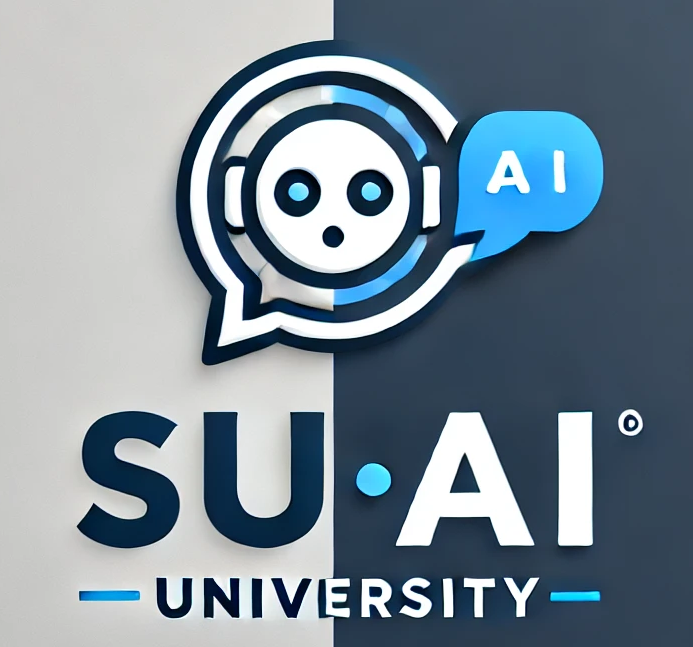
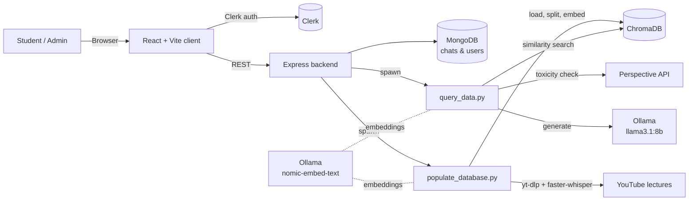

<div align="center">



# SU AI

**A course-aware AI assistant for Sabancı University students**

Ask questions about your course materials (slides, PDFs, documents and lecture videos) and get answers grounded in those materials, with sources cited.


</div>

---

## Table of Contents

- [Overview](#overview)
- [Features](#features)
- [Architecture](#architecture)
- [Tech Stack](#tech-stack)
- [Project Structure](#project-structure)
- [Getting Started](#getting-started)
- [Configuration](#configuration)
- [Usage](#usage)
- [API Reference](#api-reference)
- [Testing](#testing)
- [Roadmap](#roadmap)
- [Author](#author)

---

## Overview

SU AI is a graduation project that combines a modern chat interface with a **Retrieval-Augmented Generation (RAG)** pipeline. Course materials are organized per course (e.g. `CS201`, `CS306`), ingested into a **Chroma** vector database, and queried by a locally hosted LLM through **Ollama**. Students select a course, ask a question, and receive an answer that is generated only from that course's content, along with the files, page numbers or video titles it came from.

Instructors and admins manage the knowledge base from a dedicated admin panel: they can upload files, add YouTube lecture links, remove content, and rebuild the vector database without touching the command line.

## Features

**For students**
- 💬 Chat interface with persistent chat history per user (stored in MongoDB)
- 📚 Course selector that scopes every answer to a single course's materials
- 🔎 Source attribution: file names, PDF page numbers, and YouTube video titles
- 🤖 Switch between the **RAG model** (course-grounded) and **Gemini** (general purpose)
- 🔐 Authentication with Clerk (sign up, sign in, protected routes)

**For admins**
- 📤 Upload course files directly into a course folder
- 🎥 Add or remove YouTube lecture links per course
- 🗑️ Delete individual files or all video links
- 🔄 One-click rebuild of the vector database

**Under the hood**
- 📄 Multi-format ingestion: `.pdf`, `.pptx`, `.docx`, `.doc`, `.txt`, and `.links` (YouTube URLs)
- 🎙️ Lecture videos transcribed automatically with **faster-whisper**
- ♻️ Incremental indexing: already-processed sources are skipped, so only new material is embedded
- 🛡️ Toxicity filtering of user questions via Google's **Perspective API** (optional)
- 🎯 Similarity-threshold filtering so the model answers "no relevant information" instead of guessing

## Architecture



**Query flow**

1. The student selects a course and sends a question from the chat UI.
2. The Express backend authenticates the request with Clerk and runs `query_data.py`.
3. The question is screened for toxicity (if a Perspective API key is configured).
4. Chroma returns the top 10 chunks for that course; chunks below the similarity threshold are discarded.
5. The remaining context is passed to `llama3.1:8b` via Ollama with a "answer only from this context" prompt.
6. The answer and its de-duplicated sources are returned to the client and saved to the chat history.

**Ingestion flow**

1. Each subfolder of `data/` is treated as a course; its name becomes the `course` metadata tag.
2. Documents are loaded by type, YouTube links are transcribed, and everything is split into 800-character chunks with 80-character overlap.
3. Each chunk receives a deterministic ID (`source:page:chunk_index`) so re-running ingestion only adds new content.

## Tech Stack

| Layer | Technologies |
|---|---|
| Frontend | React 18, Vite, React Router, TanStack Query, React Markdown, Clerk |
| Backend | Node.js, Express, Mongoose, Multer, Clerk SDK |
| RAG pipeline | Python, LangChain, ChromaDB, Ollama (`llama3.1:8b`, `nomic-embed-text`) |
| Media processing | yt-dlp, FFmpeg, faster-whisper |
| Document parsing | PyPDF, python-pptx, python-docx, pypandoc |
| Infrastructure | Docker, Docker Compose, MongoDB |

## Project Structure

```
GradProj/
├── client/                    # React + Vite frontend
│   ├── public/                # Static assets (logo, icons)
│   └── src/
│       ├── components/        # ChatList, CourseList, NewPrompt
│       ├── layouts/           # Root and dashboard layouts
│       ├── lib/               # Gemini client, event emitter
│       └── routes/            # Home, sign-in/up, dashboard, chat, admin pages
├── backend/                   # Express API
│   ├── models/                # Mongoose schemas (chat, userChats)
│   ├── index.js               # API routes and Python process orchestration
│   ├── requirements.txt
│   └── Dockerfile
├── data/                      # Course materials, one folder per course
│   ├── CS201/
│   └── CS306/
│       ├── *.pdf | *.pptx | *.docx
│       └── videos.links       # One YouTube URL per line
├── populate_database.py       # Ingests data/ into Chroma
├── query_data.py              # RAG query script called by the backend
├── get_embedding_function.py  # Embedding model configuration
├── check_database.py          # Inspects the contents of the vector store
├── test_rag.py                # LLM-graded RAG accuracy tests
└── docker-compose.yml
```

## Getting Started

### Prerequisites

- **Node.js** 18+
- **Python** 3.11
- **MongoDB** (local or Atlas)
- **[Ollama](https://ollama.com/)** running locally
- **FFmpeg** and **Pandoc** (for video transcription and `.doc` files)
- A **[Clerk](https://clerk.com/)** application for authentication

### 1. Clone the repository

```bash
git clone https://github.com/bestebayhan04/GradProj.git
cd GradProj
```

### 2. Pull the Ollama models

```bash
ollama pull llama3.1:8b
ollama pull nomic-embed-text
ollama pull mistral        # only needed for test_rag.py
```

### 3. Set up the Python environment

The backend expects the virtual environment to be named `new_one` at the repository root.

```bash
python3.11 -m venv new_one
source new_one/bin/activate
pip install -r backend/requirements.txt
pip install langchain-ollama langchain-text-splitters python-dotenv requests pypandoc yt-dlp torch llama-cpp-python
```

### 4. Install the Node dependencies

```bash
cd backend && npm install && cd ..
cd client  && npm install && cd ..
```

### 5. Configure environment variables

Create the `.env` files described in [Configuration](#configuration).

### 6. Build the vector database

Place course materials in `data/<COURSE_CODE>/`, then run:

```bash
python populate_database.py          # add new materials
python populate_database.py --reset  # rebuild from scratch
```

### 7. Run the app

```bash
# Terminal 1: backend (http://localhost:5137)
cd backend && npm start

# Terminal 2: frontend (http://localhost:5173)
cd client && npm run dev
```

### Running with Docker

```bash
docker compose up --build
```

This starts the frontend, backend, MongoDB and Chroma containers. Ollama must still be reachable from the backend container.

## Configuration

> ⚠️ Never commit `.env` files. They are listed in `.gitignore`; keep real keys out of version control.

**`/.env`** (repository root, used by the Python scripts)

| Variable | Description |
|---|---|
| `PERSPECTIVE_API_KEY` | Optional. Enables toxicity filtering of questions. |

**`/backend/.env`**

| Variable | Description |
|---|---|
| `PORT` | API port (default `5137`) |
| `MONGO` | MongoDB connection string |
| `CLIENT_URL` | Frontend origin allowed by CORS, e.g. `http://localhost:5173` |
| `CLERK_PUBLISHABLE_KEY` | Clerk publishable key |
| `CLERK_SECRET_KEY` | Clerk secret key |

**`/client/.env`**

| Variable | Description |
|---|---|
| `VITE_API_URL` | Backend URL, e.g. `http://localhost:5137` |
| `VITE_CLERK_PUBLISHABLE_KEY` | Clerk publishable key |
| `VITE_GEMINI_PUBLIC_KEY` | Google Gemini API key for the general-purpose model |

## Usage

**Students**
1. Sign up or sign in.
2. Pick a course from the course list in the dashboard.
3. Select **RAG Model** from the model dropdown and ask a question.
4. Read the answer and check the listed sources.

**Admins**
1. Open `/dashboard/admin`.
2. Choose a course, upload files or add YouTube links.
3. Click **Populate Database** to index the new material.

**Command line**

```bash
python query_data.py "What are Shneiderman's golden rules?" --course CS306
python check_database.py
```

## API Reference

All routes are served from the Express backend (default `http://localhost:5137`). 🔒 marks routes that require Clerk authentication.

| Method | Endpoint | Description |
|---|---|---|
| `POST` | `/api/rag-query` 🔒 | Run a RAG query. Body: `{ query, course }` |
| `POST` | `/api/chats` 🔒 | Create a new chat |
| `GET` | `/api/userchats` 🔒 | List the current user's chats |
| `GET` | `/api/chats/:id` 🔒 | Get a chat's history |
| `PUT` | `/api/chats/:id` 🔒 | Append a message to a chat |
| `DELETE` | `/api/chats/:id` 🔒 | Delete a chat |
| `GET` | `/api/courses` | List available courses |
| `GET` | `/api/courses/:course/files` | List a course's files |
| `POST` | `/api/upload/:course` | Upload files (multipart field `files`) |
| `DELETE` | `/api/files/:course/:fileName` | Delete a course file |
| `GET` | `/api/courses/:course/video-links` | List a course's YouTube links |
| `POST` | `/api/courses/:course/video-links` | Add YouTube links to a course |
| `DELETE` | `/api/courses/:course/video-links` | Remove YouTube links from a course |
| `DELETE` | `/api/video-links/all` | Remove all video links |
| `POST` | `/api/populate-database` | Run the ingestion pipeline |

## Testing

`test_rag.py` checks answer accuracy end to end: it asks the RAG pipeline a question with a known answer, then uses a second LLM (`mistral`) to judge whether the response matches.

```bash
python -m pytest test_rag.py
# or
python test_rag.py
```

## Roadmap

- [ ] Role-based access control for the admin panel and admin API routes
- [ ] Streaming responses in the chat UI
- [ ] Inline citations linking directly to the source page or video timestamp
- [ ] Expanded evaluation suite covering every course
- [ ] Single `requirements.txt` and environment-variable-based Python path

## Author

**Beste Bayhan**, Sabancı University
Graduation Project

---

<div align="center">
<sub>Built with React, Express, LangChain and Ollama.</sub>
</div>
